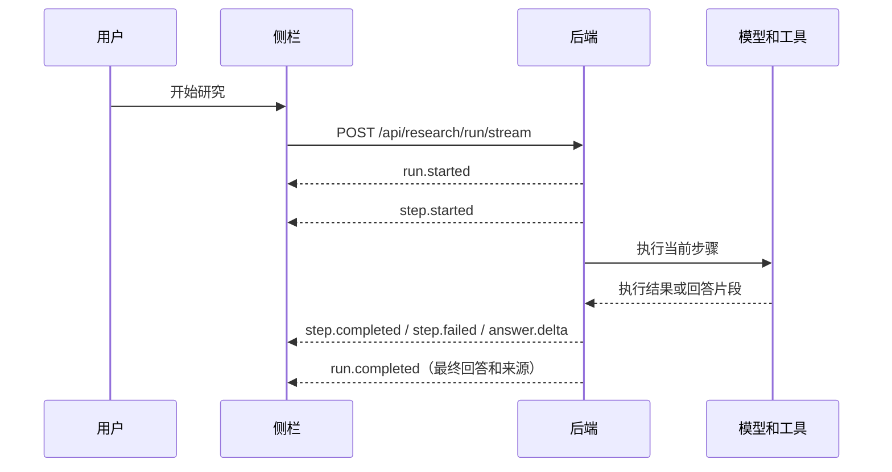

# SDD-007：流式回答、真实进度、停止和重试

## 用户会看到什么

点击“开始研究”后，侧栏显示本次执行记录。开始搜索知识库、联网搜索、读取网页时，分别出现对应步骤；工具没执行就不显示。每一步显示进行中、完成或失败，没有编造的百分比进度。

模型生成的文字分段到达后直接展示，前端每 50ms 合并一次界面更新，减少 Markdown 重绘。不是拿完整回答模拟打字。整个页面只有一个回答区：开始新任务时，旧正文让位于当前等待状态和新片段；引用整理结束后在原位置替换为最终结果。执行记录只显示步骤，不另放一份临时正文。

点击“停止生成”会中止这次请求。已收到的部分内容可继续查看，但不能作为已完成的新回答保存；上一份已完成回答和编辑中的笔记保留为备份。若已有备份，可以点“返回上一份完整回答”，也能切回本次未完成内容，两者在同一位置显示。新内容生成期间隐藏旧答案的来源及保存编辑区，避免用旧来源保存新片段。若失败前没有收到文字，显示并标明“上次完成的回答”。

点击“按原资料重试”会创建一次新任务，沿用上次的问题、网页全文快照、指定笔记 ID 和范围开关。即使已经切页或修改输入框，也不偷偷换资料。指定笔记按原 ID 读取最新内容，已删除的笔记仍提示失效。

## 一次请求怎样完成



保留原来的 `POST /api/research/run` JSON 接口，方便 Apifox 请求和兼容旧调用。新的流式接口请求体与旧接口相同，响应使用 SSE。前后端复用 `eventsource-parser` 处理分包、换行和多字节文字。

这次保持现有回答提示词和搜索、引用整理逻辑。Qwen 请求设为 `stream: true`，拼接 `delta.content`；工具调用的名称和参数也按索引拼接，完整返回后才校验和执行。

如果模型在工具决策时先返回了说明文字，侧栏可以先显示；确认调用工具后清除这一段临时文字。开始新一阶段回答时也清除旧临时文字，避免把工具计划接到最终答案上。缺失引用时的一次整理继续沿用原方式，期间显示真实的“整理回答引用”步骤，完成后替换为最终结果。

## 事件约定

所有事件带 `runId`、从 1 开始递增的 `sequence` 和 `type`。SSE 的 `event` 与 `type` 相同，`data` 是 JSON。

| 类型 | 额外内容 | 什么时候发送 |
| --- | --- | --- |
| `run.started` | 无 | 后端开始本次任务 |
| `step.started` | stepId、label、detail / links（可选） | 即将执行实际步骤 |
| `step.completed` | stepId、detail / links（可选） | 步骤成功返回 |
| `step.failed` | stepId、message | 步骤确实失败 |
| `answer.reset` | 无 | 开始新的回答阶段或转入工具执行 |
| `answer.delta` | text | 收到模型的新文字 |
| `run.completed` | result | 整个任务完成，包含原有回答和来源结构 |
| `run.failed` | message | 整个任务未完成 |

工具失败不一定代表整次任务失败。例如网页要求验证，后端发送步骤失败事件，然后可以根据用户提交的正文继续回答，并保留原有工具失败提示。

### 联网时显示哪些网页（2026-10-20）

`links` 是 `{ title, url }` 的数组，全部来自真实工具结果。搜索开始时显示本次关键词；搜索返回时显示实际找到的网页标题、域名和可打开链接。当前搜索接口一次返回整份结果，所以在返回前不显示或猜测候选网页。

读取网页开始前，就把选中的目标网页放进对应步骤；读取失败后仍保留这个链接，方便打开原文。候选列表只表示搜索到了这些网页，不表示每篇都读过。前端仅生成 HTTP/HTTPS 链接，在新标签页打开，切页继续遵循原任务快照。

沿用 `research-execution.ts`、`researchStream.ts`、`useResearchRun.ts` 和 `ResearchProgress.vue`，没有增加新的搜索或阅读工具。步骤标题与链接分别传递，显示层不从日志或回答里猜网址。

只有收到 `run.completed` 才更新“已完成回答”。中途断线、模型没有正常结束、输出长度截断，都显示未完成和重试入口，不把半截文字当成成功。

## 停止怎样传到后端

1. 侧栏调用本次 `AbortController.abort()`，关闭 fetch 请求。
2. 后端监听响应连接的 `close`，中止本次任务的控制器。
3. 同一停止信号传给 Qwen、向量生成、相关性判断、联网搜索和网页下载。
4. 每个步骤返回后再次检查停止信号，取消后不启动下一步。

停止通过关闭连接完成，因此不依赖已经关闭的连接再发一个“停止成功”事件。侧栏立即更新为“已停止”，后端负责取消外部请求。上游平台最终计费以它收到取消时的执行情况为准。

已经发给 PostgreSQL 的短查询不做强制终止；查询返回后检查停止信号，不继续相关性判断或后续生成。这里没有后台常驻任务，也没有新增任务数据库。

## 切页、断线与恢复

- 同一窗口一次只运行一个任务。生成时锁定提问和范围输入，保留停止按钮。
- 切网页或切到“我的知识”不卸载研究状态，不停止任务，不改变已提交的快照。
- 真正关闭侧栏或页面卸载会取消请求。重开侧栏提示中断，保留原问题和资料，不自动重发。
- 停止或失败的原始请求快照保存在现有窗口会话存储里，重开后仍可手动重试。旧格式没有重试快照时，仍可用恢复的草稿重新提问。
- 每次请求有自己的前端编号和后端 runId；事件顺序异常直接报错，旧请求回调不能覆盖新结果。
- SSE 只保持当前连接，不自动重连，不从上一段继续生成。重试是全新任务，可能再次发生模型和工具费用。
- 只保留最近一次任务的执行记录供当前界面查看，不保存永久历史；部分生成文字不写入知识库，也不承诺在关闭侧栏后恢复。

## 文件分工

```text
apps/api/src/research/
  research-execution.ts          本次任务的事件、实际步骤与停止信号
  research.controller.ts         POST SSE 连接、心跳与断线取消
  research.service.ts            原有流程，接入知识库与引用步骤
  research-tool-runner.service.ts 搜索和网页阅读的真实进度

apps/api/src/llm/qwen.client.ts   读取模型流，组装文字与工具参数
apps/api/test/
  research-stream.test.cjs        本地 HTTP 模型替身加真实控制器的集成检查

apps/extension/src/features/research-run/
  researchStream.ts              POST 请求、SSE 解析、运行 ID 和序号检查
  useResearchRun.ts              开始、停止、重试、临时回答和迟到请求隔离
  ResearchProgress.vue           展示步骤、停止和重试按钮
  ResearchRun.vue                组合输入、任务状态、单一回答区和保存区
  researchSession.ts             复用现有会话存储，增加原请求快照
```

## 怎样验证

先构建后端，然后运行 `npm run test:research-stream -w @researchflow/api`。测试使用本地模型替身，不连接真实百炼和数据库，覆盖片段提前到达、工具参数分片、真实步骤、失败回退、停止模型与工具请求、提前断线、长度截断和旧 JSON 接口。

扩展重新构建并加载后，分别验证：

1. 关闭联网和知识库，正文回答逐步显示，记录中没有虚构的搜索步骤。
2. 开启相应范围，实际执行工具时才出现搜索或阅读步骤。
3. 生成中停止，部分内容保留，上一份完成回答不消失。
4. 切到其他网页并修改输入框，再点“按原资料重试”，结果仍对应原问题和资料。
5. 失败或中断后重开侧栏，不自动请求模型，手动重试使用原快照。

验证记录（2026-10-19）：八项后端集成检查通过；浏览器检查覆盖流式片段提前显示、停止后上游取消、保留旧回答、切页后按原资料重试、失败重开后手动重试、搜索中停止与 320px 无横向溢出。原有资料选择、引用、草稿恢复、保存与修改笔记流程检查通过。一次实际 Qwen 请求收到 47 个回答片段，约 0.4 秒收到首片段、4.9 秒完成；本次真实请求未保存或修改笔记。

实现依据：[百炼流式输出](https://help.aliyun.com/en/model-studio/stream)、[eventsource-parser](https://github.com/rexxars/eventsource-parser)。
