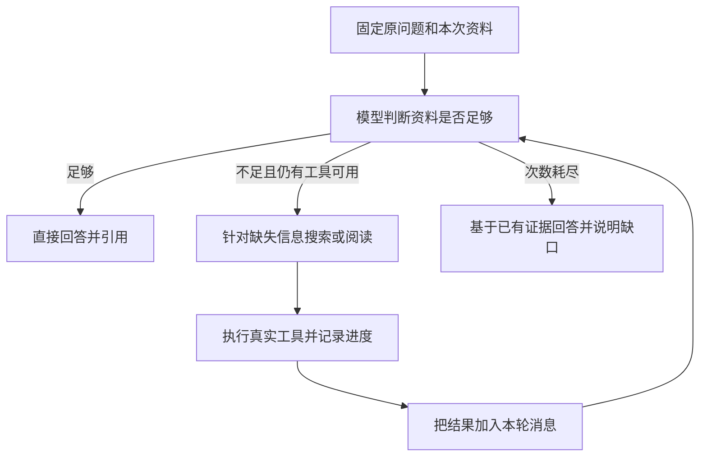

# 联网问答问题复盘：从“搜一次就结束”到按资料缺口补查

> 整理日期：2026-10-20。本文记录 ResearchFlow 这次实际遇到的问题、排查过程和已经落地的修改。当前实现以 `0c53a8b` 为基准；功能规则见 [SDD-002](SDD-002-single-task-agent.md)，全文读取见 [SDD-006](SDD-006-long-document-processing.md)。

## 一、先说清楚这次出了什么问题

用户正在阅读 Vue 的 KeepAlive 文档，并提出问题：

> KeepAlive 组件的作用是什么？有哪些具体的网站或者项目用了这个组件？

这个问题有两部分：

1. **解释组件的作用**：当前 Vue 文档已经可以提供依据。
2. **找到实际使用案例**：需要项目文档、源码或其他能说明具体用法的资料。

用户已经开启“允许联网”，但回答先后出现了这些情况：

- 直接说“当前资料没有实际案例”，没有执行搜索。
- 搜索执行了，却找到 Vue RealWorld 等没有回答到问题的教程；阅读一篇后就结束了。
- 搜索生成内容里列出了项目名称，但返回的网页未必能证明这些项目的具体用法。
- 回答变成大段“资料审计”，反复解释为什么无法确认，没有把能回答的部分组织好。
- 联网阅读只保留文章前 12,000 个字符，却没有向模型说明正文被截断。

这让我们认识到：**工具请求成功，只能说明工具运行了；找到的资料能不能回答问题，还需要继续判断。**

## 二、问题分别出在哪里

### 1. “允许联网”没有自动变成搜索行动

前端把联网开关传到了后端，后端也把搜索工具提供给了 Qwen。问题发生在模型选择工具这一步。

模型请求采用 `tool_choice: auto`，意思是模型可以选择调用工具，也可以直接回答。早期提示词只说“资料不足时可以搜索”，同时又要求“资料不足时说明限制”。模型可能选择直接说明限制，而跳过补查。

排查时使用真实 Qwen 复现过：同一个 KeepAlive 问题，工具已经传入，但模型没有返回 `tool_calls`，直接回答无法确认实际案例。

这里需要分清三个状态：

| 状态 | 它代表什么 |
| --- | --- |
| 允许联网 | 用户给了本轮使用联网工具的许可 |
| 模型返回 `tool_calls` | 模型请求程序执行某个工具 |
| 工具实际执行成功 | 程序调用了搜索或读取服务，并取得结果 |

模型写一句“建议搜索一下”，不会让程序自动执行搜索。程序也不能把勾选开关显示成已经搜索成功。

### 2. 原流程没有补查的机会

原来的程序顺序是固定的：

```text
判断是否搜索 → 搜索一次 → 选择一篇阅读 → 回答
```

即使读到的文章无关，也没有回到搜索步骤的分支。

对这个问题来说，读到一篇没有 KeepAlive 案例的 RealWorld 教程，只能说明“这篇文章没有提供所需依据”。它不能推出“网上没有案例”，也不能代表其他搜索结果都已被核对。

这个问题属于**执行流程的限制**。单纯增加一句“请认真搜索”，无法让代码中原本不存在的补查步骤自动出现。

### 3. 搜索生成内容和网页原文没有清楚地区分

当前联网工具调用百炼的联网生成接口，主要返回两部分：

```text
summary：百炼联网后生成的回答内容
sources：搜索来源的标题和 URL
```

这里的 `summary` 并不是每篇网页分别对应的一段原文摘录。它仍然是模型生成的内容，可能包含没有被返回来源充分支持的概括。

例如，生成内容说“某项目使用了 KeepAlive”，但来源列表可能主要是其他教程。如果没有对应原文，就不能直接把这个说法写成已经核实的事实。

当前已经给这类内容加上 `model-generated-unverified` 标记，并提示模型把它当作阅读线索。**这个标记用于表达资料性质，不会自动检查一句话是否真实。**

目前每次搜索仍最多保留前 5 条来源，每条主要包含标题和 URL；逐条网页摘要尚未接入，也没有更换为另一套搜索服务。

### 4. 正文截断让模型可能漏掉关键依据

旧的网页读取工具有这样的处理：

```typescript
text.slice(0, 12_000)
```

如果案例或代码在后半篇，模型根本看不到。此时模型再说“全文没有相关内容”，就超出了它实际读到的范围。

这个限制也和项目已经确定的“网页全文直传”不一致，因此应当取消。

单轮问答仍然会消耗输入 Token：问题、网页、笔记、工具结果都会占用上下文，多次工具决策还可能重新携带这些资料。但成本和等待时间应该通过实际用量观察，不能靠静默丢弃正文来处理。

### 5. 作答要求有时被模型写进了答案

此前还出现过“正确做法”“符合指令”“若用户问……”这类文字。模型开始讲解如何作答，而没有直接回答问题。

可以把它归为**指令遵循偏差**，更具体地描述为“把作答要求写进正文”。不能仅凭这个现象就认定发生了提示词注入或系统提示词泄露。

资料、问题、作答规则和引用整理任务放在一起时，模型可能没有分清最终要交付什么。我们把原问题单独放在最后，并明确主回答和引用整理都要直接回答原问题，减少这种偏移。

这不说明 JSON 格式有问题。JSON 仍然用于传递资料；改进的是问题和任务的表达方式。

## 三、现在采用什么解决方案

### 1. 明确什么时候应该补充资料

主提示词和搜索工具描述统一表达以下规则：

- 已有资料能覆盖整个问题时，可以直接回答。
- 用户已允许联网，而问题中的必要信息缺少依据时，应先补查。
- 不需要再次请求用户已经给出的联网许可。
- 搜索生成内容是线索；具体项目如何使用某项技术，需要对应正文或源码支持。
- 资料是否足够的判断留在内部，最终只输出一份直接回答问题的正文。

这解决“模型不知道什么时候应该搜索”的问题，但不能保证它每次判断都正确。

### 2. 把固定流程改成有次数上限的工具循环



模型每次看到工具结果后，可以选择：

1. 阅读一篇相关网页。
2. 发现结果偏题，调整关键词再搜索。
3. 一篇读取失败，换另一篇。
4. 资料已经足够，直接回答。

不要求每次都先读一篇再补搜。如果搜索标题已经明显偏题，模型也可以直接换词搜索。

这是一种**有次数上限的工具调用循环**。它发生在一次用户提问内部，不代表已经实现多轮聊天记忆。

### 3. 模型负责选择，程序负责执行边界

| 谁负责 | 具体工作 |
| --- | --- |
| Qwen | 判断缺少什么信息、生成搜索词、选择相关网页、决定是否继续补查或回答 |
| 后端 | 校验工具和参数、限制次数、调用真实服务、累积资料、维护来源、处理取消 |
| 前端 | 展示真实步骤、搜索词、结果网页、读取目标、失败信息和最终引用 |

当前上限如下：

| 项目 | 限制 | 原因 |
| --- | --- | --- |
| 搜索 | 整次任务最多 2 次 | 给一次调整搜索方向的机会 |
| 阅读 | 整次任务最多尝试 3 篇 | 能换页核对，同时控制请求数量 |
| 模型工具决策 | 最多 7 轮 | 避免持续返回无效工具调用 |
| 重复请求 | 相同搜索词、已尝试网页不重复执行 | 避免反复访问同一份资料 |

这些次数是整个任务共享的，不能在每轮循环里重新初始化。真实搜索、阅读失败也消耗相应次数；参数错误、重复调用会返回说明，并受决策轮数限制。

7 轮限制的是工具选择过程，不是整个后端只能请求模型 7 次。知识库相关性判断、最后无工具收尾和必要的引用整理属于其他调用，需要分别理解和观察用量。

程序只提供当前仍可用的工具。阅读工具只接受本轮搜索结果中的网页序号，不能让模型自行拼出任意 URL 去读取。

次数用完后，程序撤下工具，让模型依据已有证据收尾。上限是本项目当前的取舍，可以根据真实使用调整，不是行业统一标准。

### 4. 完整传递提取到的主要正文

联网阅读已取消前 12,000 字符截断，正文提取还做了两项修正：

- 保留原来可能漏掉的直接文字节点和表格文字。
- 避免父节点和子段落被分别拼接，造成内容重复。

HTML 下载上限由原来的约 1 MB 调整为 8 MiB。响应声明或实际下载超过容量时，明确报错，不返回半篇正文。

需要区分几种不同的长度限制：

| 限制 | 用途 |
| --- | --- |
| HTML 下载 8 MiB | 控制联网下载和本地内存使用 |
| 浏览器提交正文合计 8 MiB | 控制扩展到后端的正文传输 |
| 模型实际上下文容量 | 决定服务端能接收多少问题和资料 |
| 回答最大输出 Token | 控制生成答案的最大长度 |

这些限制不能互相等同，也不能把字符数直接当作 Token 数。

这里的完整正文，是成功获取并提取的主要正文。服务端读取 HTTP 返回的 HTML，不执行网页 JavaScript，因此无法保证取得尚待动态加载的内容。实际超过模型上下文容量时，沿用清楚的失败提示，不悄悄改成截取或分段 RAG。

引用悬停仍只展示短片段。这是界面预览，不代表模型只收到了这段文字。

### 5. 多轮搜索之后，引用仍要指向原来的文章

假设第一轮找到文章 A、B，第二轮又找到 B、C。如果直接替换来源列表，第一轮已经使用的编号可能会指向另一篇文章。

现在的处理是：

```text
第一轮：A、B
第二轮：B、C
合并后：A、B、C，已有文章的位置和引用标识保持不变
```

后端按规范化 URL 去重并追加来源，不因第二轮搜索重新编号。每篇成功阅读的网页都保留自己的正文，最终来源表分别记录它们的阅读状态和引用片段。

接口新增 `readPages` 和 `webPageReadErrors`，保存多篇读取结果及逐篇错误；旧的 `readPage` 保留最近一篇成功读取的网页，单条错误字段保留最近一次读取失败，继续兼容已有前端和历史结果。

**未读的结果仍标为搜索结果，读取失败也不会被标为成功。** 来源表记录资料取得情况；某段资料是否真的支持某个结论，仍不能只靠存在一个引用标记来证明。

### 6. 让进度跟着真实执行走

前端沿用已有事件流，不按预设时间播放“搜索完成”。

执行记录会显示：

- 模型是否请求联网。
- 第几次搜索、实际搜索词、返回的网页标题和链接。
- 第几篇阅读、正在读取的网页。
- 哪次工具执行失败。
- 模型是否结束补查并开始作答。

单篇失败后其他网页仍可能读取成功，因此界面改为逐篇显示错误，避免把某一篇的失败表现成整次任务都失败。

用户停止任务时，取消信号沿用现有机制传给模型、搜索和阅读请求。每轮执行前检查取消状态，不在停止后继续发起下一轮。

## 四、用 KeepAlive 问题走一遍

下面是帮助理解的流程示例，搜索词是示意，不是程序写死的关键词：

```text
用户问：KeepAlive 有什么作用？哪些项目用了它？

当前资料：Vue 官方文档
  └─ 能解释组件作用，没有具体项目依据

第一轮搜索：KeepAlive 实际项目案例
  └─ 返回的教程偏题，或者读完没有实际使用案例

模型继续判断：缺少的仍是“具体项目如何使用”的依据
  └─ 调整关键词，寻找相关项目的官方文档或源码

第二轮搜索后阅读相关资料
  └─ 如果读到项目缓存配置或使用说明，提取可支持的案例

最终回答：
  ├─ 依据 Vue 文档解释作用
  ├─ 依据读到的项目资料说明案例，并引用
  └─ 没有确认的部分如实说明，不补造商业网站案例
```

关键变化是：**首轮资料没有回答到问题时，可以继续查；找到足够依据后，也可以提前结束。**

## 五、代码分别负责什么

本次修改沿用已有目录，没有新建一套 Agent 框架。

| 文件 | 职责 |
| --- | --- |
| [research.service.ts](../apps/api/src/research/research.service.ts) | 组织本次任务、构建原问题与资料消息、调用工具执行器与引用整理 |
| [research-tool-runner.service.ts](../apps/api/src/research/research-tool-runner.service.ts) | 工具循环、局部状态、次数限制、去重、资料累积与结束条件 |
| [web-search.tool.ts](../apps/api/src/research/tools/web-search.tool.ts) | 调用百炼联网服务，返回生成内容和来源列表 |
| [read-web-page.tool.ts](../apps/api/src/research/tools/read-web-page.tool.ts) | 校验网页地址、下载 HTML、提取完整主要正文 |
| [research-sources.ts](../apps/api/src/research/research-sources.ts) | 构建稳定来源标识，为所有成功读取的网页匹配片段和阅读状态 |
| [research-execution.ts](../apps/api/src/research/research-execution.ts) | 发布真实步骤、回答片段及取消信号 |
| [ResearchRun.vue](../apps/extension/src/features/research-run/ResearchRun.vue) | 组合问题、进度、答案、引用和逐篇失败提示 |
| [researchApi.ts](../apps/extension/src/features/research-run/researchApi.ts) | 前端请求、返回类型及新旧字段兼容 |
| [research-stream.test.cjs](../apps/api/test/research-stream.test.cjs) | 验证工具循环、事件流、次数限制、取消及全文传递 |

工具循环中的几个主要方法也可以按下面的方式理解：

| 方法 | 用朴实的话解释 |
| --- | --- |
| `answer` | 组织整个循环，决定什么时候再次交给模型、什么时候收尾 |
| `availableTools` | 根据剩余次数和现有候选，列出现在能用的工具 |
| `nextDecisionMessage` | 告诉模型当前已有资料和剩余次数，让它继续处理原问题 |
| `executeCalls` | 校验并分发模型实际返回的工具请求 |
| `search` / `read` | 执行一次搜索或阅读，并记录成功、失败与次数 |
| `registerSources` | 把新来源加入本次列表，去重且不改旧编号 |

次数、已搜关键词和已读网页保存在请求局部状态里，不能放到 NestJS 单例 Service 的共享字段上，否则不同任务可能互相影响。

## 六、怎么验证修改有效

### 1. 自动化回归测试

对应实现完成时，前后端编译和 16 项回归测试通过。其中与本次修改直接相关的检查包括：

| 场景 | 检查内容 |
| --- | --- |
| 第一篇资料无关 | 能执行不同关键词的第二次搜索，并把新结果送回模型 |
| 两轮来源有重复 | URL 去重，旧编号保持不变，多篇正文分别匹配引用 |
| 一篇读取失败 | 可选择其他网页，失败信息和成功原文分别保留 |
| 同一批返回多个工具调用 | 实际搜索不超过 2 次，阅读不超过 3 篇 |
| 重复或无效调用 | 不重复访问相同资料，达到决策上限后收尾 |
| 第二轮搜索时停止 | 取消真实请求，不再发起后续阅读或生成 |
| 文章超过 12,000 字符 | 结尾内容仍进入模型 HTTP 请求 |
| HTML 下载超过容量 | 明确失败并取消下载，不返回截断正文 |

这些回归测试使用本地模型和工具替身，重点验证程序流程、参数传递和状态行为，不消耗百炼额度。

在已有编译产物的前提下，可以运行：

```powershell
npm run test:research-stream -w @researchflow/api
```

### 2. 真实模型检查

另外使用真实 Qwen，配合可控的搜索结果做过检查：

1. 第一轮只提供无关的 RealWorld 教程结果。
2. 模型主动换了搜索词。
3. 第二轮提供 `vue-element-admin` 官方文档作为候选。
4. 模型调用阅读工具，实际下载了该官方网页。
5. 最后依据读到的资料回答项目案例。

这验证了真实模型能够走通“发现缺口、换词补查、阅读原文、回答”的路径。

**它没有证明真实搜索服务每次都能找到该文档，也没有证明每次生成的答案都准确。** 搜索结果受控，阅读的官方网页是真实获取的，这两点需要分开说清楚。

### 3. 后续真实使用如何验收

重新加载扩展，提出 KeepAlive 问题，并查看执行记录：

- 实际搜了什么词，是否针对问题缺少的部分。
- 返回的结果是否相关，是否读了对应原文。
- 首轮不够时是否进行了合理补查。
- 回答中每个具体案例，是否有对应资料支持。
- 停止、读取失败、次数耗尽时，是否保留问题和已有回答。

不把“每次都搜索两次、阅读三篇”作为成功标准。一次就有充分依据时，提前回答才是合理行为。

## 七、这次修改的取舍与仍然存在的限制

### 为什么选择小循环

它让程序有机会修正第一轮的搜索方向，又能用固定次数控制调用数量，适合当前这个小项目。

当前继续使用已有 Qwen Client 和工具，没有引入 LangChain、LangGraph，也没有增加长期记忆、网页分段 RAG 或多 Agent。这个选择不代表这些库没有价值，而是当前流程还可以由现有代码清楚地组织起来。

### 为什么不能继续只改提示词

提示词负责表达任务，代码负责允许哪些步骤发生。原流程没有第二次搜索入口时，提示词再明确也无法让程序完成补查。

反过来，代码加入循环也不保证模型总会选到最佳关键词。因此需要同时检查提示词表达、执行流程和实际结果，不能只看某一层。

### 哪些问题还没有完全解决

- 当前搜索接口仍返回生成内容与标题、URL 列表，逐篇摘要和更细的搜索结果信息尚未接入。
- 官方来源优先目前是模型选择要求，没有独立的来源相关性排序或逐句事实核验服务。
- 网页可能需要登录、依赖 JavaScript，或者不允许服务端读取；这些情况仍可能失败。
- 读取工具目前接受 HTML 网页，PDF、纯文本下载和仓库文件专用接口尚未接入；“优先项目源码”不代表已经具备完整的仓库浏览能力。
- 多次发送完整正文可能增加 Token 用量和等待时间，需要继续根据真实记录观察。
- 模型仍可能提前结束、选错文章、重复表达或错误引用；当前程序能限制执行范围，不能保证所有答案都正确。
- 和网页端产品比较时，没有完成同模型、同资料和同搜索条件的对照，不能仅凭一次回答断言差距全部来自模型或某个工具。

后续应该先积累真实失败案例，再决定是否增加逐篇摘要、改善来源筛选或接入其他搜索能力，避免为了一个问题不断叠加零散规则。

## 八、开发过程中的教训

这次最初只验证了“模型会搜索、工具能读取”，就把修复效果说得过满。用户继续测试后，才暴露出资料无关、缺少补查和正文截断的问题。

比较完整的验收应该依次检查：

```text
工具能运行
  → 搜索能找到相关资料
  → 阅读确实取得需要的内容
  → 回答真正覆盖原问题
  → 引用能对应到支持结论的资料
```

这几步分别成功，才能逐渐说明功能可用。某一步通过，不代表后面的步骤也自动通过。

对应的几个主要提交：

| 提交 | 主要内容 |
| --- | --- |
| `cdb6d75` | 明确资料缺失时应补查，显示模型是否跳过搜索 |
| `ab9ca15` | 将搜索后的原文核对表达为明确的当前任务 |
| `521aacd` | 取消联网正文 12,000 字符截断，调整下载容量并验证正文末尾传递 |
| `0c53a8b` | 实现最多 2 次搜索、3 篇阅读的补查循环和多来源对应 |

## 九、以后讲项目时可以怎样概括

> 在阅读助手的联网问答中，我遇到了一个问题：模型虽然调用了搜索，但首轮资料偏题时，固定流程会直接结束。后来把它改成有次数上限的工具循环，由模型根据缺失信息调整关键词或换网页阅读，后端负责参数校验、次数限制、来源去重和取消执行。同时取消了正文静默截断，让资料末尾也能进入模型请求。最后通过回归测试和真实模型的可控场景检查来验证流程，继续用真实使用案例观察回答质量。

这个项目值得解释的地方，是怎样把“用户允许、模型决策、真实执行、资料依据、界面反馈”接成一个能验证的小闭环。
